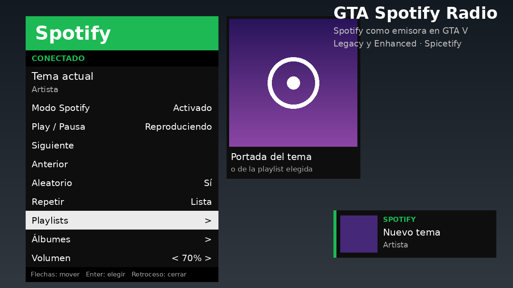

# GTA Spotify Radio

Usá Spotify como si fuera una emisora más en **GTA V** (probado en Enhanced; debería funcionar en Legacy).
*English version below.*



## Qué hace

- **Modo Spotify:** suena en el auto con la radio del juego apagada; se pausa al bajar, al apagar el motor o al poner pausa.
- **Botones de emisora:** con el modo activo, tocar el botón de cambiar emisora pasa al siguiente tema; mantenerlo desactiva Spotify y vuelve la radio del juego.
- **Menú en el juego** (contacto "Spotify" en el teléfono o **F6**): tema actual con portada, play/pausa, siguiente/anterior, aleatorio, repetir, playlists, álbumes guardados y volumen.
- **Aviso con portada** cada vez que cambia el tema.
- **Volumen automático:** baja en diálogos de historia/misiones, llamadas y cinemáticas, y vuelve a subir después.

## Cómo funciona

Son dos partes que se comunican por un WebSocket local (`ws://localhost:47823/`):

| Parte | Archivo | Dónde va |
|---|---|---|
| Script del juego | `GtaSpotify.3.cs` | `Grand Theft Auto V\scripts\` |
| Extensión de Spicetify | `gta-radio.js` | Marketplace de Spicetify o `%APPDATA%\spicetify\Extensions\` |

No se envía nada fuera de tu PC.

## Requisitos

- GTA V para PC (Legacy o Enhanced), **solo modo historia**.
- [Script Hook V](http://www.dev-c.com/gtav/scripthookv/).
- [Script Hook V .NET Enhanced](https://github.com/Chiheb-Bacha/ScriptHookVDotNetEnhanced) (funciona en Legacy y Enhanced).
- Spotify de escritorio (no el de Microsoft Store) con [Spicetify](https://spicetify.app).
- Opcional: [iFruitAddon2](https://github.com/bob74/iFruitAddon2) para el contacto en el teléfono (sin él, el menú se abre con F6).

> ⚠️ No uses mods en GTA Online: podés recibir un baneo.

## Instalación

1. Instalá Script Hook V y Script Hook V .NET Enhanced en la carpeta del juego.
2. Copiá `GtaSpotify.3.cs` a `Grand Theft Auto V\scripts\` (creá la carpeta si no existe). El juego lo compila solo al iniciar; no hace falta Visual Studio.
3. Opcional: copiá `iFruitAddon2.dll` a la misma carpeta `scripts`.
4. Instalá la extensión:
   - **Marketplace:** buscá "GTA Spotify Radio" e instalala.
   - **Manual:** copiá `gta-radio.js` a `%APPDATA%\spicetify\Extensions\` y ejecutá:
     ```
     spicetify config extensions gta-radio.js
     spicetify apply
     ```
5. Abrí Spotify, después el juego. Vas a ver "Spotify: conectado".

## Controles

| Tecla | Acción |
|---|---|
| F6 | Abrir/cerrar el menú |
| F7 | Activar/desactivar el modo Spotify |
| F8 / F9 | Tema anterior / siguiente |
| F10 / F11 | Bajar / subir volumen |
| Botón de cambiar emisora | Toque: siguiente tema · Mantener: desactivar Spotify |

Las teclas y opciones se cambian al principio de `GtaSpotify.3.cs`. Después de editarlo, apretá **Insert** en el juego para recargar los scripts.

## Emisora personalizada (opcional)

El script también puede reemplazar una emisora del juego por un MP3 propio que suena "en vivo", con nombres de canciones desde una lista. Está desactivado por defecto (`CustomRadioEnabled`). Los archivos van en `Documentos\gta-spotify\radios\` (`.mp3`, `.txt` con `inicio|artista|título` por línea y `.png` con el logo). Usá solo música que tengas derecho a usar.

## Problemas comunes

- **No aparece "conectado":** revisá que Spotify esté abierto y que la extensión esté activa (`spicetify apply`).
- **El script no carga:** el compilador del juego solo admite C# 5. Mirá `ScriptHookVDotNet.log` y la consola de SHVDN (F4).
- **Logs:** `Documentos\gta-spotify\logs\`.

## Licencia

MIT. Ver [LICENSE](LICENSE). Proyecto no oficial, sin relación con Rockstar Games, Take-Two ni Spotify.

---

# GTA Spotify Radio (English)

Use Spotify as just another radio station in **GTA V** (tested on Enhanced; should work on Legacy).

## Features

- **Spotify mode:** plays in your car with the game radio off; pauses when you get out, turn off the engine or pause the game.
- **Radio buttons:** with Spotify mode on, tapping "next station" skips the track; holding it turns Spotify off and brings back the game radio.
- **In-game menu** (phone contact "Spotify" or **F6**): current track with cover, play/pause, next/previous, shuffle, repeat, playlists, saved albums and volume.
- **Track toast with cover art.**
- **Auto-ducking** during story/mission dialogues, phone calls and cutscenes.

## How it works

A game script (`GtaSpotify.3.cs`) and a Spicetify extension (`gta-radio.js`) talk over a local WebSocket (`ws://localhost:47823/`). Nothing leaves your PC.

## Requirements

- GTA V for PC (Legacy or Enhanced), **story mode only** — don't use mods online.
- [Script Hook V](http://www.dev-c.com/gtav/scripthookv/) and [Script Hook V .NET Enhanced](https://github.com/Chiheb-Bacha/ScriptHookVDotNetEnhanced).
- Spotify desktop (not the Microsoft Store version) with [Spicetify](https://spicetify.app).
- Optional: [iFruitAddon2](https://github.com/bob74/iFruitAddon2) for the phone contact.

## Install

1. Install Script Hook V and Script Hook V .NET Enhanced.
2. Copy `GtaSpotify.3.cs` to `Grand Theft Auto V\scripts\`. The game compiles it on startup.
3. Optional: copy `iFruitAddon2.dll` to the same `scripts` folder.
4. Install the extension from the Spicetify Marketplace, or copy `gta-radio.js` to `%APPDATA%\spicetify\Extensions\` and run `spicetify config extensions gta-radio.js` and `spicetify apply`.
5. Open Spotify, then the game. You'll see "Spotify: conectado".

## Controls

F6 menu · F7 Spotify mode · F8/F9 previous/next · F10/F11 volume · Radio button: tap = next track, hold = turn Spotify off. Keys can be changed at the top of `GtaSpotify.3.cs` (press **Insert** in game to reload).

## License

MIT. Unofficial project, not affiliated with Rockstar Games, Take-Two or Spotify.
